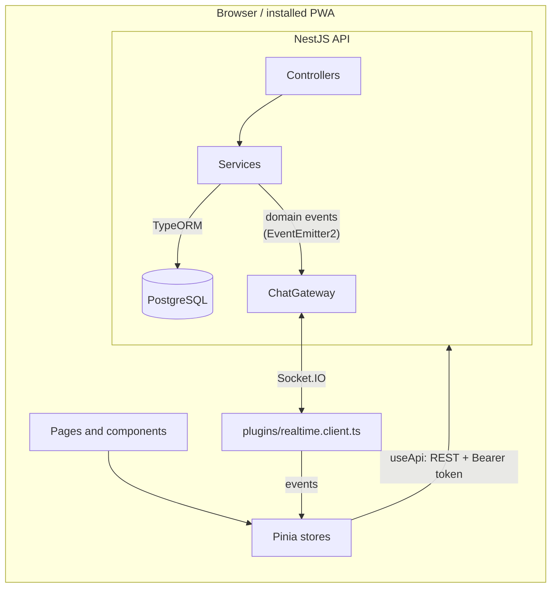
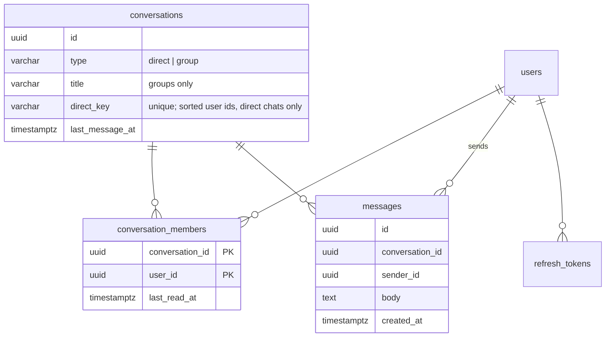

# Architecture

## Sending a message

1. `MessageComposer` emits `send`. `messages.send()` adds an **optimistic** message (`status: 'sending'`, with a random `clientId`) so it shows up instantly.
2. `POST /api/conversations/:id/messages { body, clientId }`. `MessagesService.send()` checks membership. In one transaction it inserts the message and bumps `conversations.last_message_at`.
3. The service emits `MessageCreatedEvent`. `ChatGateway.onMessageCreated` sends `message:new` to the room `conversation:<id>`, which every member's sockets have joined.
4. Each client merges the message with `mergeMessages()`. Duplicates are ignored, and the sender's optimistic bubble is replaced by matching `clientId`. Both the HTTP response and the socket push go through the same merge, so it does not matter which arrives first.
5. The receiver's open chat page calls `POST /conversations/:id/read`. `ChatGateway` then sends `read:updated`, and the sender sees "Seen".

If the request fails, the bubble shows "Not sent. Tap to retry". Retrying reuses the same `clientId`.

## Authentication

| Token         | Where it lives                                      | Lifetime   |
| ------------- | --------------------------------------------------- | ---------- |
| Access (JWT)  | JS memory only (Pinia `auth` store)                 | 15 minutes |
| Refresh token | `httpOnly` cookie, `Path=/api/auth`, `SameSite=Lax` | 30 days    |

- On page load, `auth.global.ts` calls `POST /auth/refresh`. If the cookie is valid, the user is signed in without typing anything.
- `useApi()` retries any request that fails with 401 once, after a refresh. Concurrent 401s share a single refresh request.
- Refresh tokens are **rotated** on every use. The database stores only a SHA-256 hash (`refresh_tokens`). A rotated token keeps working for 30 seconds, so two tabs refreshing at once don't sign each other out. Logout deletes the row immediately.
- Sockets send the access token in `handshake.auth.token`. A middleware in `ChatGateway.afterInit` rejects invalid tokens. The client then refreshes and reconnects (`connect_error` handler).
- Every HTTP route requires a token unless it is decorated with `@Public()` (see `JwtAuthGuard`).

## Realtime rooms and events

- `user:<userId>`: all sockets (tabs and devices) of one user.
- `conversation:<id>`: all sockets of all members. Joined on connect, and added on the fly when a conversation is created (`socketsJoin`).

| Event (server → client) | When                                          |
| ----------------------- | --------------------------------------------- |
| `message:new`           | A message was saved                           |
| `conversation:updated`  | A conversation was created (you're in it)     |
| `read:updated`          | A member marked a conversation as read        |
| `presence:snapshot`     | On connect: which of your contacts are online |
| `presence:updated`      | A contact came online / went offline          |
| `typing:updated`        | A member started/stopped typing               |

Client → server: `typing:start`, `typing:stop`. The server relays them only to rooms the socket has joined, so you can't spy on other conversations.

All names and payload types live in `packages/shared/src/events.ts`, and both sides use the typed `Server<…>` / `Socket<…>` generics.

After a reconnect (for example a phone waking up), the web app refetches the conversation list and the newest page of the open chat. That catches up on anything missed while offline.

## Data model

- **Unread count**: messages from others with `created_at > last_read_at`. It is computed in SQL, and `last_read_at` is set with the database clock (`now()`), so there are no rounding issues between JavaScript and PostgreSQL timestamps.
- **History pagination** uses a cursor: `?before=<messageId>` compares `(created_at, id)` in SQL, which is stable even when two messages share a timestamp.

## PWA

- `@vite-pwa/nuxt` generates the manifest and a Workbox service worker that precaches the app shell (JS, CSS, HTML, icons). API calls are **not** cached, so chat data is never stale.
- `registerType: 'prompt'`: when a new version is deployed, `AppStatusBanner` shows "A new version is available" with a Reload button, so a half-typed message is never lost to a surprise reload.
- `InstallAppCard` (Settings) uses the browser install prompt where one exists (Android, desktop Chrome/Edge) and shows "Share → Add to Home Screen" instructions on iOS.
- Mobile details: `100dvh` layouts, `viewport-fit=cover` with `env(safe-area-inset-*)` padding, and `interactive-widget=resizes-content` so the keyboard doesn't cover the composer.

## Scaling out

The starter is designed for **one API instance**:

- Presence is a `Map` in `PresenceService`.
- Socket.IO rooms exist only inside one process.

To run several instances behind a load balancer:

1. Add the Socket.IO Redis adapter (`@socket.io/redis-adapter`) in `SocketIoAdapter`, so emits reach sockets on every instance.
2. Move `PresenceService` counters to Redis (`INCR`/`DECR` per user, with a TTL heartbeat).
3. Enable sticky sessions, or keep `transports: ['websocket']` (the default here), which avoids long-polling.
